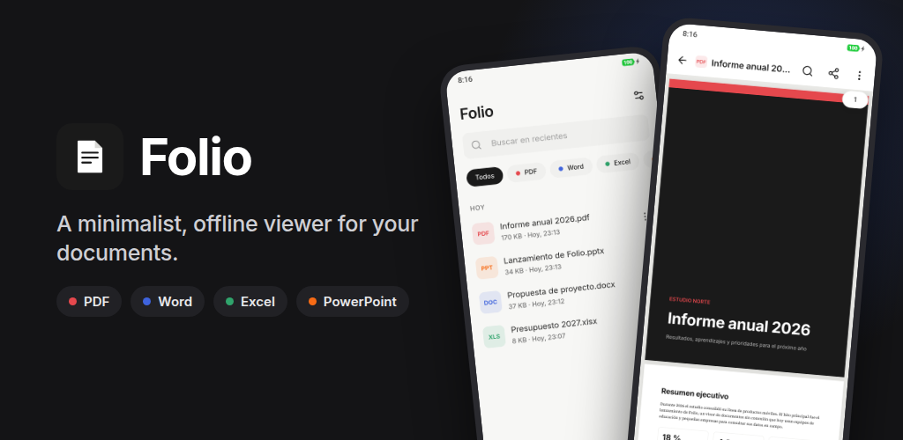
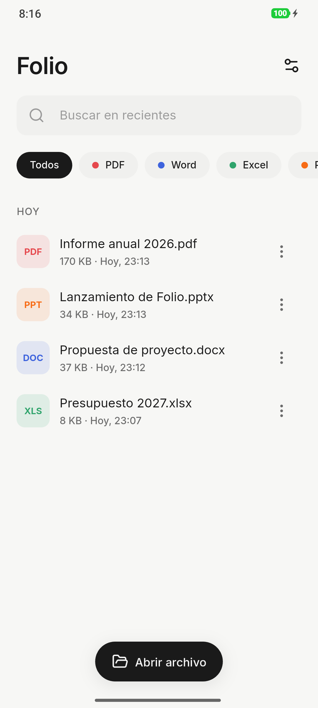
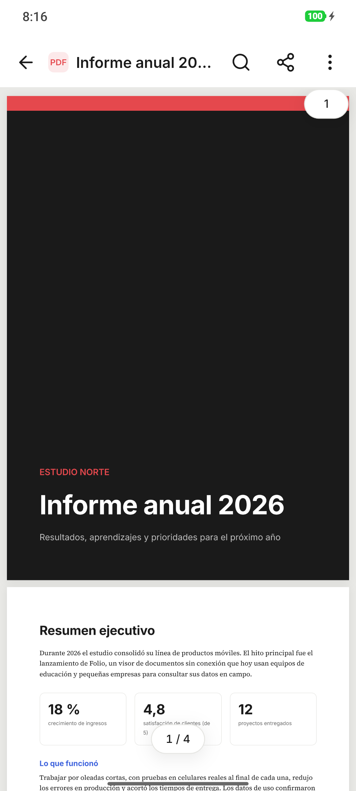
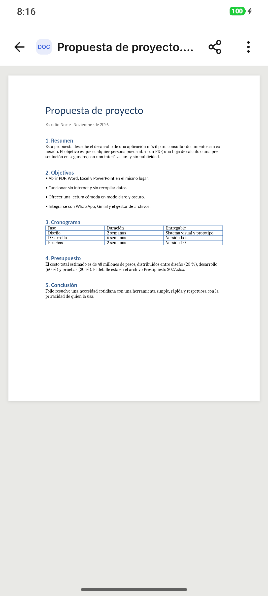
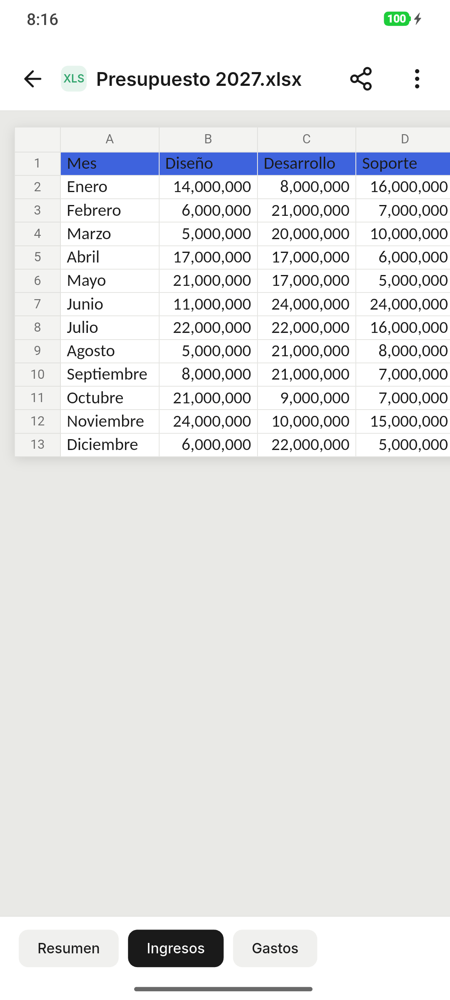
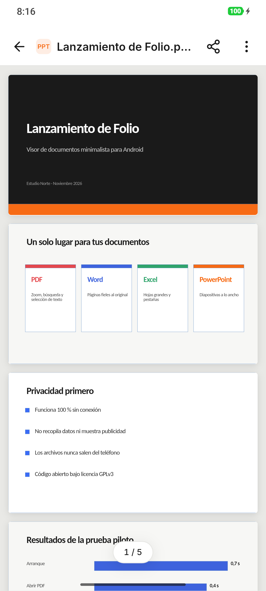
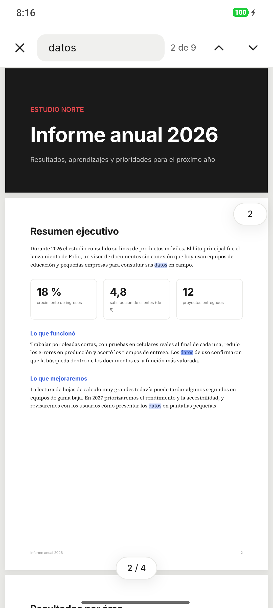
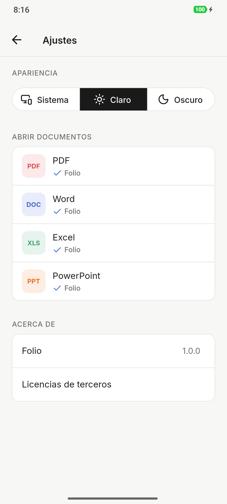
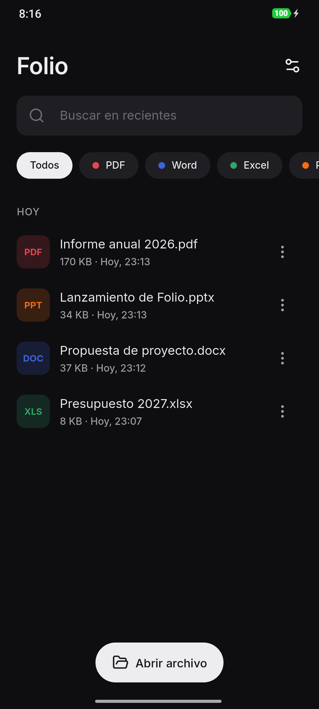

<div align="center">
  
  <h2>Folio</h2>
  <h4>Visor de documentos minimalista y sin conexión para Android</h4>

  <p>
    <a href="https://github.com/y0ner/folio/releases/latest">
      
    </a>
  </p>

  <p>
    <a href="https://github.com/y0ner/folio/releases/latest">
      
    </a>
    <a href="LICENSE">
      
    </a>
    
    
    
    
  </p>

  <p>
    <a href="README.md">English</a> &middot; Español
  </p>

  <p>
    <a href="#capturas">Capturas</a> &bull;
    <a href="#funciones">Funciones</a> &bull;
    <a href="#formatos-compatibles">Formatos compatibles</a> &bull;
    <a href="#descarga-e-instalación">Descarga</a> &bull;
    <a href="#compilar-desde-el-código">Compilar</a> &bull;
    <a href="#contribuir">Contribuir</a> &bull;
    <a href="#licencia">Licencia</a>
  </p>

  <p>
    <a href="https://folio-visor.vercel.app">Sitio web</a> &bull;
    <a href="https://github.com/y0ner/folio/releases/latest">Lanzamientos</a> &bull;
    <a href="CHANGELOG.md">Historial de cambios</a>
  </p>

  <p>Versión actual: <strong>1.0.0</strong> &mdash; <a href="CHANGELOG.md">notas de la versión</a></p>
</div>

---

## Capturas

<p align="center">
  
</p>

<p align="center">
  
  
  
  
  <br/>
  
  
  
  
</p>

## Descripción

Folio es un visor minimalista de solo lectura para Android diseñado con una estética sobria de «tinta y papel» donde el protagonista es el documento. Abre archivos PDF, Word, Excel y PowerPoint completamente sin conexión, sin anuncios, sin cuentas y sin recopilar datos.

## Funciones

### Lectura y visualización

- **PDF nativo** (PDFium vía `pdfrx`): zoom con pellizco y doble toque, selección de texto, enlaces internos, PDF protegidos con contraseña y **búsqueda dentro del PDF** con resaltado y contador de coincidencias.
- **Word** (`docx-preview`): páginas fieles al original con fuentes empaquetadas compatibles con Calibri, Cambria, Arial y Times (Carlito, Caladea y Liberation).
- **Excel** (SheetJS): encabezados fijos, celdas combinadas, pestañas por hoja y **desplazamiento fluido en hojas de hasta 20 000 filas** mediante ventana virtual y lectura en Web Worker.
- **PowerPoint** (`pptx-preview`): lista de diapositivas ajustadas a lo ancho con carga progresiva.
- **Modo inmersivo**: un toque oculta o muestra las barras; incluye indicador flotante `3 / 24` y diálogo para ir directo a una página.

### Gestión de archivos

- **Recientes organizados**: agrupados en **Hoy**, **Esta semana** y **Anteriores**, con búsqueda que ignora tildes y mayúsculas y filtros por formato.
- **Apertura directa**: abre archivos desde el selector del sistema o usando **Abrir con** / **Compartir** desde otras apps (WhatsApp, Gmail, gestor de archivos).
- **Visor predeterminado por formato**: en **Ajustes &rarr; Abrir documentos** puedes ver qué app abre cada tipo y saltar al selector de Android para elegir Folio con **Siempre**.
- **Detalles y acciones**: consulta la **ruta real** del archivo con botón **Copiar ruta**, guarda una copia en otra carpeta (**Guardar una copia…**) o comparte el documento.

### Comodidad

- **Tema claro, oscuro o del sistema**, con neutros cálidos e insignias por tipo (PDF rojo, Word azul, Excel verde, PowerPoint naranja).
- **Tipografía e iconos empaquetados**: fuente Inter e iconos Lucide incluidos en la app, sin descargas externas.

### Privacidad

- **100 % sin conexión**: Folio no se conecta a internet, no carga recursos remotos y no incluye analítica ni telemetría.

## Formatos compatibles

| Formato | Extensiones | Motor |
| :--- | :--- | :--- |
| **PDF** | `.pdf` | PDFium nativo (`pdfrx`) |
| **Word** | `.docx`, `.docm`, `.dotx` | `docx-preview` 0.4.1 (WebView sin red) |
| **Excel** | `.xlsx`, `.xlsm`, `.xls`, `.csv` | SheetJS CE 0.20.3 (WebView sin red + Web Worker) |
| **PowerPoint** | `.pptx`, `.ppsx`, `.pptm` | `pptx-preview` 1.0.7 (WebView sin red) |

> Los formatos binarios antiguos (`.doc` y `.ppt`) no están admitidos.

## Descarga e instalación

- **Último APK**: descarga `folio-v1.0.0-arm64.apk` (~34 MB) desde [GitHub Releases](https://github.com/y0ner/folio/releases/latest).
- **Requisitos**: Android 7.0 o superior (`minSdk 24`), arquitectura `arm64-v8a` recomendada.

### Cómo instalar

1. Descarga `folio-v1.0.0-arm64.apk` en tu teléfono Android.
2. Abre el archivo y, si el sistema lo pide, permite instalar aplicaciones de fuentes desconocidas desde tu navegador o gestor de archivos.
3. Para dejar Folio como visor predeterminado por tipo, entra a **Ajustes &rarr; Abrir documentos**, toca **Elegir Folio** (o **Cambiar** si ya hay otra app asignada) y elige **Siempre** en el selector de Android.

### Certificado de firma del APK

Puedes verificar la autenticidad del APK oficial comparando su huella SHA-256:

```text
Propietario: CN=Folio, OU=y0ner, C=CO
SHA-256: 8E:1A:B0:DE:25:7E:BF:3D:FF:28:8B:0A:59:47:6E:C4:D9:93:EC:65:47:98:B3:53:BF:23:20:FD:E0:19:F8:E4
```

## Privacidad

Folio funciona completamente sin conexión y no recopila, almacena ni envía datos del usuario. El manifiesto de Android solo declara el permiso `INTERNET` porque el componente WebView lo exige para crearse al abrir Word, Excel y PowerPoint; todos los motores y documentos se cargan desde dentro de la propia app y cualquier URL externa se bloquea.

## Compilar desde el código

**Requisitos previos:** Flutter 3.47+ (Dart 3.13+) y Android SDK.

```bash
./run.sh android   # Ejecutar en un Android conectado por USB (adb)
./run.sh linux     # Ejecutar en escritorio Linux (Word/Excel/PowerPoint solo en Android)
./run.sh apk       # Compilar el APK release
./run.sh install   # Compilar el APK release arm64 e instalarlo por adb
./run.sh test      # Correr las pruebas (flutter test)
./run.sh analyze   # Ejecutar análisis estático (flutter analyze)
```

## Arquitectura y tecnologías

- **Base**: Flutter 3.47 / Dart 3.13 con sistema de diseño Material 3 propio (`FolioTokens`, `FolioColors`, `FolioTheme`).
- **Motores**: `pdfrx` (PDFium) para PDF; `flutter_inappwebview` + motores web empaquetados (`docx-preview` 0.4.1, SheetJS CE 0.20.3, `pptx-preview` 1.0.7) para Office.

```text
lib/
  main.dart, app.dart        Arranque, tema, AppScope
  core/                      Servicios compartidos, ingesta de archivos, DocumentRef, DocKind, tema, ajustes
  ui/                        Widgets reutilizables (insignia de tipo, estado vacío, cabeceras)
  features/
    home/                    Recientes, búsqueda y filtros por tipo
    settings/                Apariencia, apps predeterminadas y licencias
    viewer/                  ViewerController, ViewerScreen, visores PDF y Office
assets/engines/              Motores JS empaquetados, fuentes locales (Carlito/Caladea/Liberation) y puentes CSS/JS
```

## Cómo se construyó

Folio se desarrolló mediante un flujo coordinado con agentes de IA: un agente jefe (Claude Code) redactó los briefs técnicos, gestionó ramas y *worktrees* aislados, revisó cada PR y ejecutó pruebas y compilaciones, mientras agentes trabajadores (Gemini) implementaron las tareas por oleadas—con revisión final y pruebas en un celular Android real (ver [`AGENTS.md`](AGENTS.md) y `docs/agentes/`).

## Contribuir

Los reportes de errores y propuestas de mejora son bienvenidos. Lee [`CONTRIBUTING.md`](CONTRIBUTING.md) antes de enviar un issue o pull request.

## Terceros

Consulta [`THIRD_PARTY_NOTICES.md`](THIRD_PARTY_NOTICES.md) para ver la lista completa de fuentes, motores JavaScript y bibliotecas incluidas con sus versiones y licencias.

## Licencia

Folio es software libre: puedes redistribuirlo y/o modificarlo bajo los términos de la Licencia Pública General de GNU publicada por la Free Software Foundation, ya sea la versión 3 de la Licencia o (a tu elección) cualquier versión posterior.

Consulta [`LICENSE`](LICENSE) para leer el texto completo de la licencia.
