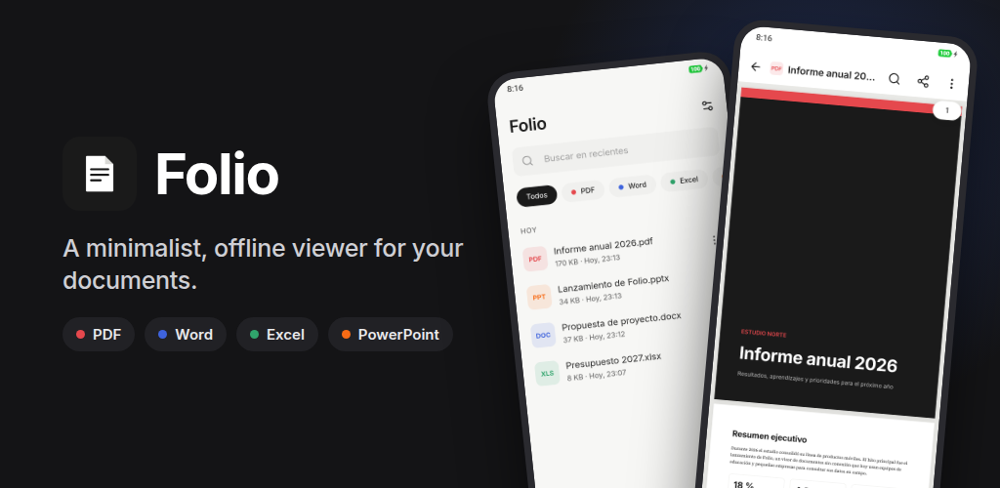
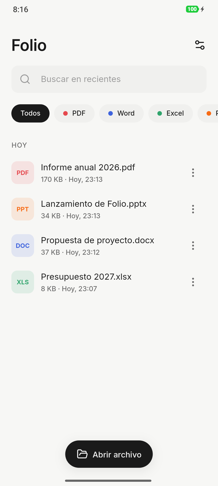
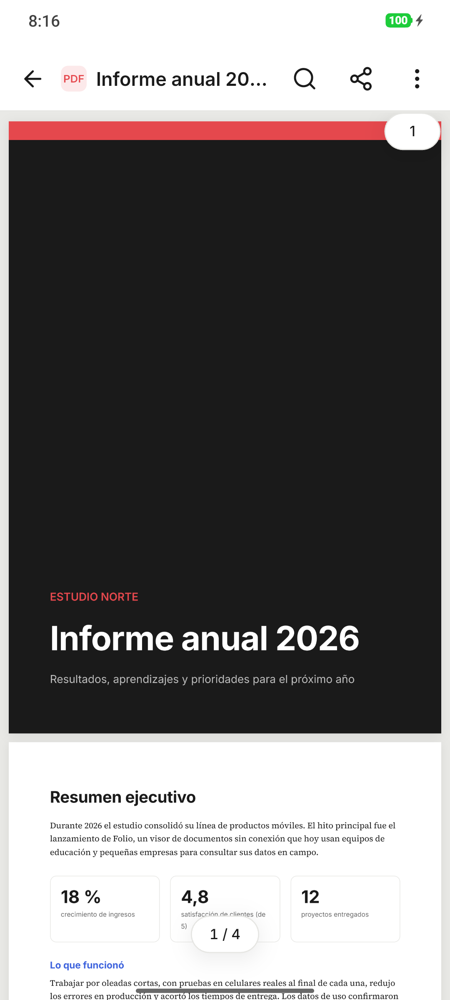
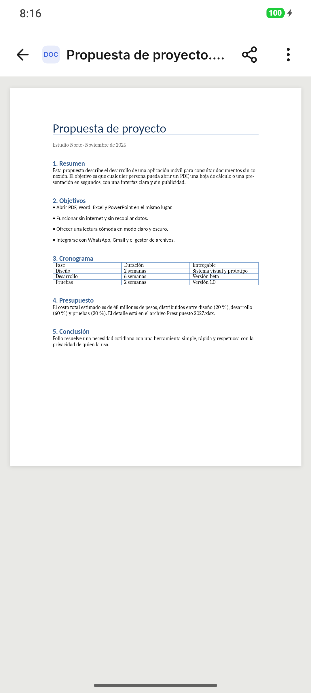
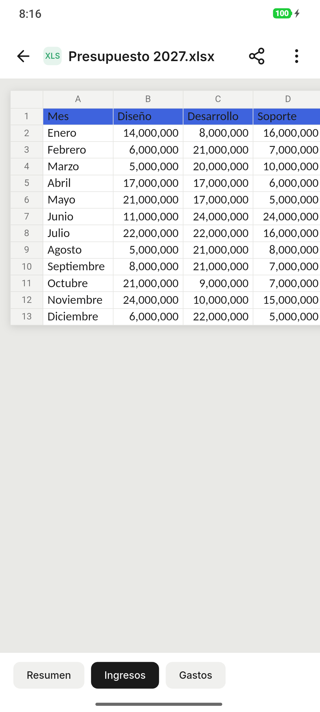
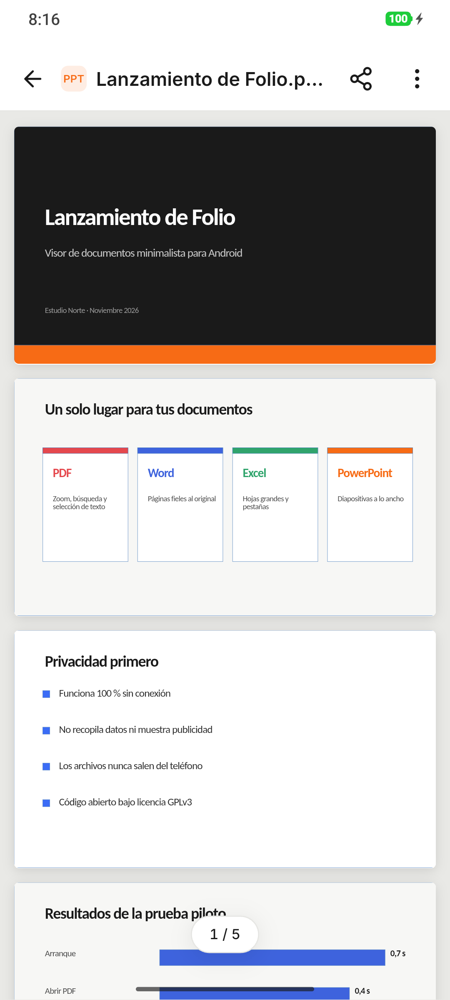
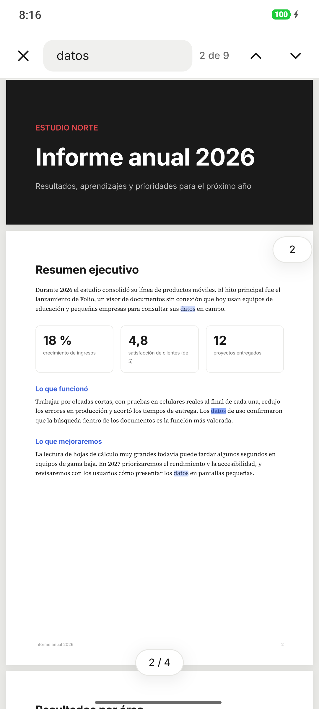
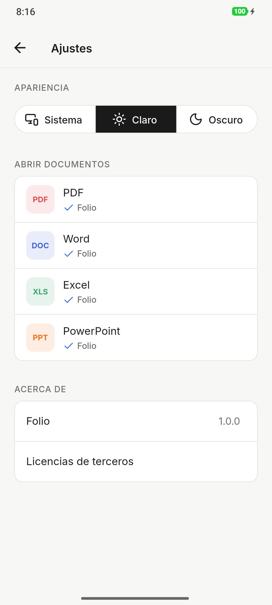
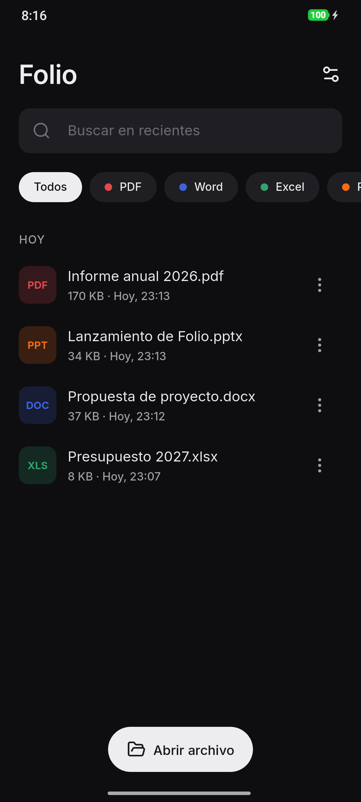

<div align="center">
  
  <h2>Folio</h2>
  <h4>A minimalist, offline document viewer for Android</h4>

  <p>
    <a href="https://github.com/y0ner/folio/releases/latest">
      
    </a>
  </p>

  <p>
    <a href="https://github.com/y0ner/folio/releases/latest">
      
    </a>
    <a href="LICENSE">
      
    </a>
    
    
    
    
  </p>

  <p>
    English &middot; <a href="README.es.md">Español</a>
  </p>

  <p>
    <a href="#screenshots">Screenshots</a> &bull;
    <a href="#features">Features</a> &bull;
    <a href="#supported-formats">Supported formats</a> &bull;
    <a href="#download--installation">Download</a> &bull;
    <a href="#building-from-source">Building</a> &bull;
    <a href="#contributing">Contributing</a> &bull;
    <a href="#license">License</a>
  </p>

  <p>
    <a href="https://folio-visor.vercel.app">Website</a> &bull;
    <a href="https://github.com/y0ner/folio/releases/latest">Releases</a> &bull;
    <a href="CHANGELOG.md">Changelog</a>
  </p>

  <p>Current version: <strong>1.0.0</strong> &mdash; <a href="CHANGELOG.md">release notes</a></p>
</div>

---

## Screenshots

<p align="center">
  
</p>

<p align="center">
  
  
  
  
  <br/>
  
  
  
  
</p>

## Description

Folio is a lightweight, read-only document viewer for Android built around a quiet "ink and paper" interface where the document always comes first. It opens PDF, Word, Excel, and PowerPoint files entirely offline, with zero ads, zero accounts, and zero telemetry.

## Features

### Viewing

- **Native PDF viewer** (PDFium via `pdfrx`): pinch-to-zoom, double-tap zoom, text selection, internal links, password-protected PDF support, and **in-PDF search** with highlighted matches and result counter.
- **Word documents** (`docx-preview`): faithful page layout using bundled fonts compatible with Calibri, Cambria, Arial, and Times (Carlito, Caladea, and Liberation).
- **Spreadsheets** (SheetJS): sticky headers, merged cells, sheet switcher tabs, and **smooth scrolling for sheets up to 20,000 rows** powered by a virtualized viewport and Web Worker parsing.
- **Presentations** (`pptx-preview`): full-width vertical slide list with progressive loading.
- **Immersive reading**: tap once on the document to hide or show bars, track progress with the floating `3 / 24` page pill, and jump directly with **Go to page**.

### Files

- **Organized recents**: grouped into **Today**, **This week**, and **Older**, with instant accent- and case-insensitive search and format filter chips.
- **Seamless intake**: open files from Android's system picker or via **Open with** / **Share** from apps like WhatsApp, Gmail, or your file manager.
- **Default viewer setup**: inspect which app currently opens each document type under **Settings &rarr; Open documents** and launch Android's chooser to set Folio with **Always**.
- **File details & actions**: view the **real file path** with one-tap **Copy path**, save a copy to another folder (**Save a copy…**), or share the document.

### Comfort

- **Light, dark, and system themes** with warm neutral surfaces and color-coded file badges (PDF red, Word blue, Excel green, PowerPoint orange).
- **Bundled typography & icons**: Inter typeface and Lucide icons with zero external asset loading.

### Privacy

- **100% offline**: Folio never connects to the internet, loads no remote scripts or fonts, and collects no analytics or personal data.

## Supported formats

| Format | Extensions | Engine |
| :--- | :--- | :--- |
| **PDF** | `.pdf` | Native PDFium (`pdfrx`) |
| **Word** | `.docx`, `.docm`, `.dotx` | `docx-preview` 0.4.1 (offline WebView) |
| **Excel** | `.xlsx`, `.xlsm`, `.xls`, `.csv` | SheetJS CE 0.20.3 (offline WebView + Web Worker) |
| **PowerPoint** | `.pptx`, `.ppsx`, `.pptm` | `pptx-preview` 1.0.7 (offline WebView) |

> Legacy binary Office formats (`.doc` and `.ppt`) are not supported.

## Download & installation

- **Latest APK**: download `folio-v1.0.0-arm64.apk` (~34 MB) from [GitHub Releases](https://github.com/y0ner/folio/releases/latest).
- **Requirements**: Android 7.0 or higher (`minSdk 24`), `arm64-v8a` recommended.

### Installing the APK

1. Download `folio-v1.0.0-arm64.apk` on your Android device.
2. Open the downloaded file and allow installation from unknown sources for your browser or file manager if prompted.
3. To make Folio your default viewer per document type, open **Settings &rarr; Open documents** inside Folio, tap **Choose Folio** (or **Change** if another app is currently assigned), and select **Always** in the Android chooser.

### APK signing certificate

You can verify the authenticity of the official release APK against this signing certificate:

```text
Owner: CN=Folio, OU=y0ner, C=CO
SHA-256: 8E:1A:B0:DE:25:7E:BF:3D:FF:28:8B:0A:59:47:6E:C4:D9:93:EC:65:47:98:B3:53:BF:23:20:FD:E0:19:F8:E4
```

## Privacy

Folio works completely offline and does not collect, store, or transmit any user data. The Android manifest declares the `INTERNET` permission solely because Android's WebView requires it to instantiate for rendering Word, Excel, and PowerPoint documents; all engines and files are loaded from local app assets and any external URL navigation is blocked.

## Building from source

**Prerequisites:** Flutter 3.47+ (Dart 3.13+) and the Android SDK.

```bash
./run.sh android   # Run on a USB-connected Android device (adb)
./run.sh linux     # Run on Linux desktop (Word/Excel/PowerPoint viewers require Android)
./run.sh apk       # Build the release APK
./run.sh install   # Build the arm64 release APK and install via adb
./run.sh test      # Run unit and widget tests (flutter test)
./run.sh analyze   # Run static analysis (flutter analyze)
```

## Tech stack & architecture

- **Framework**: Flutter 3.47 / Dart 3.13 with a bespoke Material 3 theme (`FolioTokens`, `FolioColors`, `FolioTheme`).
- **Engines**: `pdfrx` (PDFium) for PDFs; `flutter_inappwebview` + bundled offline web engines (`docx-preview` 0.4.1, SheetJS CE 0.20.3, `pptx-preview` 1.0.7) for Office documents.

```text
lib/
  main.dart, app.dart        App startup, theme wiring, AppScope
  core/                      Shared services, file intake, DocumentRef, DocKind, theme, settings
  ui/                        Shared widgets (type badge, empty state, section headers)
  features/
    home/                    Recents list, search, format filters
    settings/                Theme switcher, default document handlers, licenses
    viewer/                  ViewerController, ViewerScreen, PDF & Office viewers
assets/engines/              Bundled JS engines, offline fonts (Carlito/Caladea/Liberation), CSS/JS bridges
```

## How it was built

Folio was built through a structured AI-agent development workflow: a lead agent (Claude Code) authored task briefs, managed isolated git worktrees and branches, reviewed pull requests, and ran tests and builds, while worker agents (Gemini) implemented tasks in parallel waves—followed by code review and real-device Android verification (see [`AGENTS.md`](AGENTS.md) and `docs/agentes/`).

## Contributing

Bug reports, feature discussions, and pull requests are welcome. Please read [`CONTRIBUTING.md`](CONTRIBUTING.md) before contributing.

## Third-party

See [`THIRD_PARTY_NOTICES.md`](THIRD_PARTY_NOTICES.md) for the complete list of bundled fonts, JavaScript engines, and native libraries with their versions and licenses.

## License

Folio is free software: you can redistribute it and/or modify it under the terms of the GNU General Public License as published by the Free Software Foundation, either version 3 of the License, or (at your option) any later version.

See [`LICENSE`](LICENSE) for the full license text.
